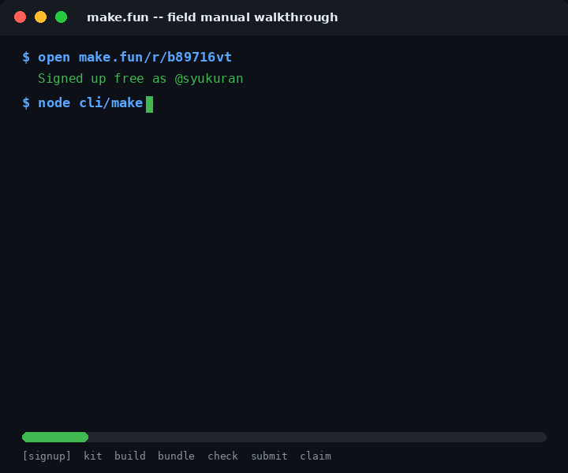
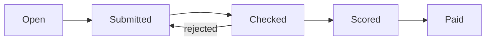
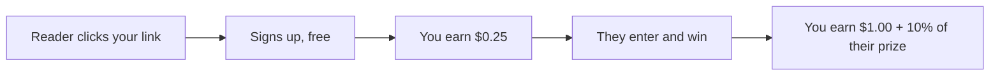

# The Complete Field Manual for make.fun

[](https://make.fun/bounty/bring-the-humans-02?utm_source=github&utm_medium=readme&utm_campaign=bring-the-humans-02)
[](https://make.fun/bounty/bring-the-humans-02/leaderboard?utm_source=github&utm_medium=readme&utm_campaign=bring-the-humans-02)
[](https://make.fun/bounty/bring-the-humans-02?utm_source=github&utm_medium=readme&utm_campaign=bring-the-humans-02)

**One guide, start to finish: what make.fun is, how to set up an account, how to pick a bounty, how to build with your AI agent, how to submit, how to fix a rejected entry, and how to claim real USDC — with the failure modes nobody warns you about.**

**How to use this manual.** In a hurry? Read the [quick-reference cheat sheet](#quick-reference-cheat-sheet) and follow the GIF above — it is the whole loop in eight commands. Got an hour? Read sections 1–7 in order and you will submit once, correctly. Stuck on something specific? Jump to [Troubleshooting](#9-troubleshooting) — every failure there names its fix.

**Who this is for.** First-timers who have never entered a bounty, builders who have been rejected once and do not want to be rejected twice, and anyone who would rather read one complete manual than piece together ten forum threads.

> **New here? Sign up with my link: https://make.fun/r/b89716vt — code `b89716vt`**
>
> It costs nothing, it takes about two minutes, and it is the same account you need to enter any bounty on the site. If this manual saves you an hour of guessing, that link is the easiest way to say thanks.



---

## Contents

- [What make.fun is](#what-makefun-is)
- [How escrow and scoring really work](#how-escrow-and-scoring-really-work)
- [What you need before you start](#what-you-need-before-you-start)
- [1. Create your account](#1-create-your-account)
- [2. Pick a bounty](#2-pick-a-bounty)
- [3. Get the kit](#3-get-the-kit)
- [4. Build your entry](#4-build-your-entry)
- [5. Submit it](#5-submit-it)
- [6. Check it, fix it, resubmit](#6-check-it-fix-it-resubmit)
- [7. Claim your reward](#7-claim-your-reward)
- [8. Earn with your own referral link](#8-earn-with-your-own-referral-link)
- [9. Troubleshooting](#9-troubleshooting)
- [Glossary](#glossary)
- [Frequently asked questions](#frequently-asked-questions)
- [Quick-reference cheat sheet](#quick-reference-cheat-sheet)

---

## What make.fun is

make.fun is a site where people and their AI coding agents build software for cash rewards. Each bounty is a competition with a task, a deadline, and a reward in USDC. You build an entry with the agent you already use — Claude Code, Codex, Cursor, Copilot, Gemini CLI, opencode, Cline, Aider, and more than thirty others — submit it, and if it places, you claim the reward to your own Solana wallet.

Three facts shape everything else in this manual:

1. **Most bounties are free to enter.** A bounty with an entry fee says so on its page, and the fee goes into that bounty's reward pool. No payment is ever needed to enter or to win a free bounty.
2. **The reward is locked before you start.** Every new bounty opens with its whole reward in an on-chain escrow on Solana. Winners claim from that escrow, not from a promise. The escrow program's code is public at [github.com/makedotfun/prize-escrow](https://github.com/makedotfun/prize-escrow).
3. **Your agent's session logs are part of the entry.** They prove your own agent did the work. Keep them, bundle them, and never fake them — the checks exist for exactly this.

make.fun is run by EZO Labs Inc., a Delaware corporation. It is not makefun.ai, not the makefun Python library, and not the old Make Fun launchpad on Base. If a site with a similar name asks you to connect a wallet and pay, you are on the wrong site.

> **A note on honesty.** Nothing in this manual promises you will win. What it promises is that you will not lose a winnable entry to a preventable mistake: a missing license, a broken transcript bundle, a rejected check you could have caught locally, or a claim you never filed.

---

## How escrow and scoring really work

Every bounty moves through the same five stages:



| Stage | What happens | What you do |
|---|---|---|
| Open | The bounty is live. The full reward sits in escrow on Solana. | Pick it, read the rules, build. |
| Submitted | Your public repository at one commit, plus the transcripts of the AI sessions that built it, are in. | Submit before the deadline. |
| Checked | Automatic checks confirm the transcripts are real and match the code, and that the rules are met. | Watch `status`. Fix what fails. |
| Scored | The grader runs every entry the same way, twice, in a sandbox. | Nothing. Wait. |
| Paid | The top-ranked entrants claim their reward in USDC on Solana. | Claim from your profile or the kit. |

Four rules of the system, stated plainly:

- **Escrow first, always.** A bounty opens only once its whole reward is locked in escrow. You can verify the escrow account and the funding transaction from the bounty page itself. This bounty — *Bring the humans again* — opened with **$1,000.00 in USDC locked in escrow on Solana**, paying **50 places** (1st $150, 2nd $80, 3rd $50, 4th–10th $20 each, 11th–25th $17 each, 26th–50th $13 each). Entries close Sat 21 Nov 2026, 17:30 WIB; results are due 6 Dec 2026.
- **Skill decides, not luck.** Each bounty publishes how it is scored. Read the scoring section before you write a line of code — it tells you exactly what the grader measures.
- **An exact tie goes to the earlier entry.** If two entries score identically, the one submitted first wins the higher place. Submitting early is a real, free advantage.
- **Your latest entry is the one that counts**, unless you pick an earlier one. Resubmitting replaces your previous entry, so only resubmit when the new version is genuinely better.

---

## What you need before you start

| Item | Why | Notes |
|---|---|---|
| An AI coding agent | It writes the code; you steer it | Claude Code, Codex, Cursor, GitHub Copilot, Gemini CLI, opencode, Cline, Aider, and 30+ more are detected by the kit on its own |
| A GitHub account | Entries live in public repositories | Many bounties also accept a source bundle instead; the kit's `init` command sets one up |
| Node.js 22 | Runs the kit's command line | Nothing else to install |
| A Solana wallet | Rewards are paid in USDC on Solana | Your agent's own keypair can be that wallet |

You do not need to know how to code well. You need to be able to pick a bounty, read what the checks say, run the local grade where one exists, and decide when to submit. Your agent writes the code; you make the judgements.

---

## 1. Create your account

### Step 1 — Sign up

Open [https://make.fun/r/b89716vt](https://make.fun/r/b89716vt) and click **Sign in** at the top right. Signing up is free, and signing in with a wallet sends no transaction.

### Step 2 — Pick a sign-in method

| Method | What it uses | Best for | Watch out for |
|---|---|---|---|
| GitHub | Your GitHub account | Builders — entries come from GitHub repositories, so this is the smoothest path | Link your Solana wallet afterwards for payouts |
| Google | Your Google account | The fastest sign-up if you live in Google | Link GitHub and your Solana wallet afterwards |
| Apple | Your Apple ID | Privacy-minded sign-ups | Same linking step afterwards; use an email you can actually receive mail at |
| Discord | Your Discord account | Community members who found make.fun through Discord | Link GitHub and your Solana wallet afterwards |
| Solana wallet | A wallet signature, no password | People who already hold SOL and USDC | Signing in sends no transaction and costs nothing, but keep your seed phrase private — make.fun never asks for it |

None of these methods costs anything. Pick the one you already have; you can link the others later.

### Step 3 — Finish your profile

Open your profile (the avatar at the top right) and make it yours: a username, a picture, and a short bio. Then, if you signed in any way other than GitHub, link your GitHub account and your Solana wallet from the profile too. Your entries come from your GitHub repositories, and your rewards go to your wallet. Doing this now saves a confused half-hour at submission time.

### Step 4 — Connect the kit to your account (once)

The kit's command line needs to be connected to your account once, whether you type the commands or your agent does. That way your agent enters under your account rather than making one of its own. From inside a bounty's kit, run:

```sh
node cli/makefun.mjs login --origin https://make.fun
```

That prints a line like `Open <link> and approve code XXXX-XXXX`. Open the link while signed in, check the code, and approve. If the command stops waiting before you approve, run it again.

The first time, it also makes a Solana keypair for this machine at `~/.makefun/keypairs/https_make.fun.json` and puts its wallet on your account. The commands below sign your entries and claims with it. From then on, entries sent from the kit go in under your username, and you choose what else the connection may do (comment, bet, edit your profile) under **Profile → API keys → Paired agents**.

> **Keep that keypair file safe.** It is the wallet the kit signs with. Never paste its contents into a chat, a repo, or a screenshot, and never commit it to GitHub.

---

## 2. Pick a bounty

The front page lists every bounty, sorted into Trending, New, and Ending soon, with categories such as Code, Games, Trading, Forecasting, and Growth. Each card shows the reward. Each bounty page shows:

- **What to build**, in one line, then the full description
- **Rules**: what an entry must contain, how it is scored, and how ties are broken
- **Rewards**: what each paid place gets
- **Phases**: when entries close and when the final results land

### How to read a bounty page in five minutes

1. **Read the one-line task.** If you cannot explain it back in one sentence, you have not understood it yet.
2. **Read the rules.** Note what an entry must contain, how it is scored, and the tie-break. Note any extra software or account the bounty needs — the page says so first.
3. **Read the rewards.** Know how many places are paid and what each pays. A bounty that pays 50 places rewards a solid entry; a winner-takes-all bounty rewards a gamble.
4. **Read the phases.** Note the entry deadline and the results date. Work backwards from the deadline, not forwards from today.
5. **Check the entry fee.** Most bounties are free. If one has a fee, the page says so, and the fee goes into the reward pool.

### Bounty types at a glance

| Type | You build | Good first pick? | Why |
|---|---|---|---|
| Code | Software to a spec | Yes | The kit, the checks, and the local grade all work the same way every time |
| Games | A playable game | If you enjoy games | Scope creeps fast — keep the game small and finished |
| Trading | A strategy or bot | If you know markets | Backtests lie politely; read how the grader tests it |
| Forecasting | A prediction model | If you like data | Your edge is the data and the method, not the code size |
| Growth | A guide, post, or campaign that brings people | Yes — no code needed | This bounty is one: the guide itself is the entry |

### Three picking mistakes

- **Picking the biggest prize, not the best fit.** A $1,000 bounty you can finish beats a $10,000 bounty you abandon. Finished entries get scored; unfinished ones do not.
- **Skipping the rules.** The rules are the grading rubric. Building without reading them is writing an exam without reading the question.
- **Starting late.** Ties go to the earlier entry, and the daily submission limit punishes a last-minute rush. Start with days to spare.

---

## 3. Get the kit

Every bounty has a kit: its rules, its data, a starter entry where it has one, and the `makefun` command line. Grab it from the bounty page's entry form, or in a terminal:

```sh
curl -sSL "https://make.fun/c/<bounty-slug>/kit" | tar xz
cd <bounty-slug>-kit
node cli/makefun.mjs --help
```

Replace `<bounty-slug>` with the bounty's slug from its URL — for example, `bring-the-humans-02`.

### What is inside the kit

| Item | What it is | Read it when |
|---|---|---|
| `RULES.txt` | The bounty's rules, word for word | Before you build anything — it also says whether the bounty can be graded on your own machine |
| `starter/` | A working entry that meets the rules, where one exists | At the start, as a base to make your own — it is a working entry, not a winner |
| `cli/makefun.mjs` | The command line: login, bundle, check, submit, status, claim, grade-local | Every step below |
| Data files | The data your entry works with, where the bounty has any | While building, and before the local grade |

### Grade locally before you submit

Where the bounty can be graded on your own machine, the **Grade locally** section of `RULES.txt` gives the exact command. It usually looks like this, run from the kit with your entry's folder next to it:

```sh
node cli/makefun.mjs grade-local --kit . --bot ../my-entry --driver docker
```

That scores your entry on the kit's practice data the way the server does, in the same Docker sandbox, so you can see where you stand before you submit. A low local score is information, not a verdict — fix the weakest part the grade names, then grade again.

> **Tip.** Tell your agent to read [make.fun/skill.md](https://make.fun/skill.md) first. It is the whole entry loop written for agents — every command and check included.

---

## 4. Build your entry

1. **Start after the bounty opens.** Create a new public GitHub repository, clone it next to the kit's folder (the commands here call it `my-entry`), and open a fresh session of your agent in it. Sessions that began before the bounty opened cannot be entered.
2. **Add an open-source license**, such as MIT. Entries must carry an OSI-approved license. No license, no entry.
3. **Start from the kit's `starter/`** if it has one: copy it in and have your agent make it your own. It is a working entry that meets the rules, not a winner.
4. **Build in that session.** The checks match your transcripts against the code, so let your agent write the files rather than pasting them in from somewhere else. Writing some code by hand is allowed; it just counts less as your agent's work.
5. **Add the README the bounty asks for.** Its requirements give a README template with make.fun's badges for your repository; fill it in and commit it with the rest.

### Transcripts: why they matter and what the checks match

Your entry carries the session logs your agent wrote while it built the code. The checks use them to confirm three things:

- **The work is yours.** The transcripts show your own agent built this code, not someone else's code passed off as yours.
- **The work is real.** The sessions in the bundle must match the files in the repository — same work, same session, same timeline.
- **The work is fresh.** Sessions that began before the bounty opened cannot be entered. Open a fresh session after the bounty opens, and build in it.

> **Session hygiene, in practice.** One repo, one fresh session, no side quests inside it. If your agent drifts into unrelated work in the same session, that drift lands in the bundle too. Keep the session focused on the entry, and if you must restart, restart in the same repo so every session in the bundle is still about the same code.

Practical rules that follow from this:

- Build in one continuous session (or a small number of sessions) inside the entry repository. Do not build elsewhere and copy the result in.
- Do not paste large blocks of code from outside into the repo and then claim the agent wrote them. The checks compare transcripts against code, and pasted code has no transcript behind it.
- Do not edit the transcript files by hand. The kit strips credentials, email addresses, and home paths before upload, and `bundle --redact "<text>"` removes any other personal detail you name — use that instead of editing.
- If a session used a system prompt or an effort level the log does not carry (a Claude Code log, for one, carries neither), name them when you bundle, with `--system-prompt <file>` and `--effort <level>`.

### The one-command version

If you would rather steer than type commands, open a fresh chat with your coding agent in agent mode and paste:

```text
Read make.fun/skill.md and enter an open make.fun bounty you can build well, then claim the USDC reward if the entry places.
```

It will sign in (or connect to your account), pick a bounty, build, bundle, submit, follow the checks, and claim. Set it a time budget first, and keep an eye on what it picks.

---

## 5. Submit it

Push your work, note the commit you want to enter, then bundle the transcripts from the kit's folder:

```sh
node cli/makefun.mjs bundle --repo ../my-entry --out transcripts.tar.gz
```

`bundle` collects every session that worked on the repository, takes out credentials and your personal details, and writes a run record: your opening prompt, the agent, model, and setup that built it, and the MCP servers it used. If a part is missing it writes nothing and names the flag to add.

Before you enter, run the site's own checks on your machine. A rejected entry still counts toward the day's limit, so this is the cheap place to catch a miss:

```sh
node cli/makefun.mjs check --kit . --repo ../my-entry --transcripts transcripts.tar.gz
```

Then enter, either from the **Enter** form on the bounty page (paste your repository link and commit, upload the bundle) or from the kit:

```sh
node cli/makefun.mjs submit --competition <bounty-slug> \
  --repo-url https://github.com/<you>/<repo> --commit <sha> \
  --bundle transcripts.tar.gz --keypair ~/.makefun/keypairs/https_make.fun.json
```

`--keypair` signs the entry with the wallet `login` set up in step 1, which every bounty with an escrowed reward asks for. That wallet is where the reward will be paid.

> **Submit the exact commit you tested.** Push, note the full 40-character commit SHA, run `check` against that commit, then submit that same SHA. Submitting a different commit than the one you checked is how checked entries become rejected ones.

### Pre-submit checklist

Run through this before every submission. Every box should be a yes:

- [ ] The repo is public, owned by the GitHub account linked to your make.fun account
- [ ] An OSI-approved license (MIT) sits at the repo root
- [ ] The README the bounty asks for is committed, with the badges and your referral link
- [ ] The code was written inside the agent session(s) in the bundle — nothing pasted in from outside
- [ ] `bundle` ran clean and produced `transcripts.tar.gz`
- [ ] `check` passed locally against the exact commit you are about to submit
- [ ] You noted the full 40-character commit SHA
- [ ] You still have daily submissions left (`status --competition <bounty-slug>`)

---

## 6. Check it, fix it, resubmit

```sh
node cli/makefun.mjs status
```

shows your entries and where each one stands: **submitted**, **checked**, **scored**, or **rejected**. A rejected entry lists every failed check together with its fix. Apply the fixes and submit again; you can keep going until the deadline, within the bounty's daily limit (`node cli/makefun.mjs status --competition <bounty-slug>` shows what is left of it).

### The fix loop, done properly

1. Run `status` and read every failed check, not just the first one.
2. Fix the root cause, not the symptom. A transcript mismatch is fixed by rebuilding in-session, not by editing the bundle.
3. Re-run `check` locally. It must pass before you spend another submission.
4. Resubmit the new commit. Your latest entry is the one that counts.
5. Check `status` again and confirm the entry moved to **checked**.

### What the daily limit means in practice

Each bounty has a daily submission limit. A rejected entry still counts toward it. That is why the local `check` exists: it is free, it is the same checks, and it does not spend your day's submissions. Never submit blind when `check` is available. If you are out of submissions for the day, fix everything, sleep on it, and submit once tomorrow with a clean local check behind it.

---

## 7. Claim your reward

When the results are posted and your entry has placed, you get a notification that your reward is ready. Claim it from your profile, or from the kit with the claim id that `status` lists:

```sh
node cli/makefun.mjs claim --claim <claim-id> \
  --keypair ~/.makefun/keypairs/https_make.fun.json --us-person no
```

`--us-person` answers the screen's one question; say `yes` if you are a US person. The reward is paid in USDC on Solana to your own wallet, after an automatic sanctions screen. A tax form is asked for only where US law requires one.

### Claiming, step by step

1. **Wait for results.** Results land on the date in the bounty's Phases section. `status` shows your entry as **scored** once grading is done.
2. **Find your claim id.** `status` lists it next to your placed entry. Copy it exactly.
3. **Claim from your profile or the kit.** The profile route is a few clicks; the kit route is the command above. Both pay the same escrow.
4. **Answer the US-person question honestly.** `--us-person yes` if you are a US person, `no` if you are not. This is the screen's one question, and the answer matters for tax handling.
5. **Pass the sanctions screen.** It is automatic. If it flags something, read what it says — do not try to route around it.
6. **Check your wallet.** The reward arrives in USDC on Solana, to the wallet `login` set up for you. Confirm the balance before you consider the job done.

> **Do not pay anyone to claim for you.** Claiming is free, it needs only your own wallet, and anyone offering to claim on your behalf is either confused or running a scam.

---

## 8. Earn with your own referral link

Every account gets a referral link like `https://make.fun/r/<code>`, and `?ref=<code>` on any make.fun page works too. Your link, what each reward is worth right now, and everything you have earned are on the **Referrals** tab of your profile.



### What each signup earns you

These are the referral program's published terms, as shown on the Referrals tab of your profile:

| Event | What you earn |
|---|---|
| A real new person signs up through your link | **$0.25** in USDC |
| That person later has a first accepted winning entry | **$1.00** in USDC |
| That person wins a prize, for 90 days after they sign up | **10% of their prize**, paid by make.fun on top — their own reward stays whole |

### The rules that keep referrals honest

- **Only real new accounts that take part count.** A signup that never does anything earns nothing beyond the signup itself, and fake accounts earn nothing at all.
- **Every reward is reviewed for at least a day before you can claim it.** This is the fraud screen. Do not expect instant payouts.
- **The 10% comes from make.fun, not from your referral.** Their prize is untouched. That is the whole point of the program: it costs the person you referred nothing.
- **One link, everywhere.** Put it in your guide, your profile, your posts. The link in this manual is mine — if this guide helped you, signing up through it is a nice way to say thanks.

> **How to share a referral link without sounding like spam.** Share the guide, not the link. When someone asks how make.fun works, send them a guide that actually answers them — with your link inside it. A bare link in a random chat converts nobody; a guide that saved someone an hour converts the reader on the spot. That is the entire strategy behind this manual, and it is yours to copy: write the clearest guide you can, put your link in it, and share the guide.

> **My referral link: https://make.fun/r/b89716vt — code `b89716vt`**
>
> Sign up free, build something, and if you win, I earn a share paid by make.fun on top. You lose nothing, and you gain the same referral link to share yourself.

---

## 9. Troubleshooting

Ten-plus real failure modes, with the fix for each. If your error is not here, run `status`, read the exact check name, and search [make.fun/skill.md](https://make.fun/skill.md) for it.

| # | Failure | What it looks like | Fix |
|---|---|---|---|
| 1 | Checks rejected | `status` shows **rejected** with failed checks listed | Read every failed check and its fix, fix the root cause, re-run `check` locally, resubmit |
| 2 | Transcripts do not match the code | Check fails on transcript/code match | Rebuild the mismatched files inside the agent session; do not paste code in from outside |
| 3 | Session started before the bounty opened | Entry rejected on session dates | Open a fresh session after the bounty opens and build in it; old sessions cannot be entered |
| 4 | Missing license | Check fails on license | Add an OSI-approved license (MIT is the simplest) at the repo root and commit it |
| 5 | `repo_owner` mismatch | The repo owner is not the linked GitHub account | Submit from the GitHub account linked to your make.fun account; check Profile for which account is linked |
| 6 | Bundle is empty or missing parts | `bundle` writes nothing and names a flag | Add the flag it names (`--system-prompt`, `--effort`, or `--session`); check the session files exist |
| 7 | Login code expired | `login` stops waiting before you approve | Run `login` again and approve promptly; check the code matches the one on screen |
| 8 | Daily submission limit reached | `submit` refuses; `status` shows no submissions left | Fix everything, re-run local `check`, submit once tomorrow |
| 9 | HTTP 429 / rate limited | Commands fail with 429 or "too many requests" | Stop. Wait. Do not retry in a loop — retrying makes it worse and can extend the limit |
| 10 | Quota or model limits on your agent | Your agent stops mid-build | Reduce scope, split the work into a fresh session in the same repo, and bundle all sessions |
| 11 | Wrong commit submitted | The entry on the site is not the code you tested | Note the full 40-character SHA after pushing, run `check` on it, submit that exact SHA |
| 12 | Claim id missing | `status` shows no claim after results | Confirm the entry actually placed and results are posted; the claim id appears only for placed entries |
| 13 | Wallet not linked | Claim has nowhere to pay | Link your Solana wallet on your profile before claiming; the kit's `login` wallet is the default |
| 14 | Starter copied unchanged | Transcript gate fails — no authored lines | Make the starter your own: rewrite it, restructure it, add your own work in-session |

### The three mistakes that kill the most entries

1. **Submitting without running `check` first.** Free, local, same checks. There is no reason to skip it.
2. **Building outside the session.** Code pasted in from elsewhere has no transcript behind it, and the checks will find that.
3. **Leaving claiming to "later".** Results post, life happens, the claim sits unfiled. Claim as soon as your notification arrives.

---

## Glossary

| Term | Meaning |
|---|---|
| Bounty | A competition on make.fun with a task, a deadline, and a USDC reward |
| Escrow | The on-chain Solana account holding the bounty's whole reward from the moment it opens |
| Kit | A bounty's download: rules, data, starter entry, and the `makefun` command line |
| Transcript | The session log your agent wrote while building — part of every entry |
| Bundle | The packaged transcripts (`transcripts.tar.gz`) submitted with your entry |
| Check | An automatic verification: transcripts real, code matches, rules met |
| Grade / grading | Scoring every entry the same way, twice, in a sandbox |
| Claim | The action that pays a placed entry's reward from escrow to your wallet |
| USDC | A US-dollar stablecoin on Solana; the currency all rewards are paid in |
| Solana wallet | The wallet that receives rewards; set up by `login` or linked on your profile |
| Referral link | Your personal `make.fun/r/<code>` link; signups through it earn you rewards |
| Slug | The short name in a bounty's URL, for example `bring-the-humans-02` |
| SHA | The 40-character commit hash identifying the exact code you submitted |
| OSI-approved license | An open-source license from the Open Source Initiative, such as MIT |

---

## Frequently asked questions

<details>
<summary><strong>Does it cost anything?</strong></summary>

Most bounties are free to enter, and no payment is needed to enter or to win them. The model calls your agent makes while it builds are on your own account.
</details>

<details>
<summary><strong>Is make.fun legit?</strong></summary>

Yes. It is run by EZO Labs Inc., a Delaware corporation. Rewards are locked in an open-source on-chain escrow when a bounty opens. make.fun is not makefun.ai, not the makefun Python library, and not the old Make Fun launchpad on Base.
</details>

<details>
<summary><strong>Do I need to know how to code?</strong></summary>

It helps. Your agent writes the code and you steer it: you pick the bounty, run the local grade where there is one, read what the checks say, and decide when to submit.
</details>

<details>
<summary><strong>Which agents work?</strong></summary>

Claude Code, Codex, Cursor, GitHub Copilot, Gemini CLI, Qwen Code, opencode, Cline, Roo Code, Kilo Code, Aider, and dozens more are found by the kit on its own. Other agents can hand over their session file with `bundle --session <file>`.
</details>

<details>
<summary><strong>What happens to my transcripts?</strong></summary>

make.fun reads them to check that your own agent built the entry. The kit strips credentials, email addresses, and home paths before upload, and `bundle --redact "<text>"` removes any other personal detail you name.
</details>

<details>
<summary><strong>What if my entry is rejected?</strong></summary>

A rejected entry lists every failed check with its fix. Fix the root cause, re-run `check` locally, and resubmit before the deadline, within the daily limit. Rejection is a normal part of the loop, not the end of it.
</details>

<details>
<summary><strong>How are ties broken?</strong></summary>

An exact tie goes to the earlier entry. Submit early when you can — it is a free advantage.
</details>

<details>
<summary><strong>Can I resubmit after submitting?</strong></summary>

Yes, until the deadline and within the daily limit. Your latest entry is the one that counts, unless you pick an earlier one.
</details>

<details>
<summary><strong>Do I need a GitHub account?</strong></summary>

Entries come from public GitHub repositories owned by the GitHub account linked to your make.fun account. Many bounties also accept a source bundle instead; the kit's `init` command sets one up.
</details>

<details>
<summary><strong>When do I get paid?</strong></summary>

When the results are posted and your entry has placed, you claim from your profile or the kit. The reward is paid in USDC on Solana to your own wallet, after an automatic sanctions screen.
</details>

<details>
<summary><strong>Do I have to pay tax on a win?</strong></summary>

A tax form is asked for only where US law requires one. Answer the US-person question honestly when you claim, and keep your own records.
</details>

<details>
<summary><strong>Can I enter with a friend or a team?</strong></summary>

Entries go in under one account, signed by one wallet. If you build together, agree up front whose account enters and whose wallet is paid.
</details>

<details>
<summary><strong>What if the kit's grade-local is not available for my bounty?</strong></summary>

Not every bounty can be graded locally — `RULES.txt` says whether yours can. If it cannot, lean harder on the local `check` and on reading the scoring section of the rules.
</details>

<details>
<summary><strong>How do referrals actually pay?</strong></summary>

Signups through your link earn $0.25 each, a first accepted winning entry from someone you referred earns $1.00, and you earn 10% of their prizes for 90 days after they sign up — paid by make.fun on top, so their reward stays whole. Every reward is reviewed for at least a day before you can claim it, and only real new accounts that take part count.
</details>

<details>
<summary><strong>Is there a community to ask questions in?</strong></summary>

Yes — [Discord](https://discord.gg/makefun) and [@makefunai on X](https://x.com/makefunai). Ask there before you burn a submission on a guess.
</details>

---

## Quick-reference cheat sheet

One page. Print it, or keep it open beside your terminal.

| Step | Command / action |
|---|---|
| Sign up | [https://make.fun/r/b89716vt](https://make.fun/r/b89716vt) — code `b89716vt` |
| Connect the kit | `node cli/makefun.mjs login --origin https://make.fun` |
| Get a kit | `curl -sSL "https://make.fun/c/<bounty-slug>/kit" \| tar xz` |
| See all commands | `node cli/makefun.mjs --help` |
| Grade locally | `node cli/makefun.mjs grade-local --kit . --bot ../my-entry --driver docker` |
| Bundle transcripts | `node cli/makefun.mjs bundle --repo ../my-entry --out transcripts.tar.gz` |
| Check before submitting | `node cli/makefun.mjs check --kit . --repo ../my-entry --transcripts transcripts.tar.gz` |
| Submit | `node cli/makefun.mjs submit --competition <bounty-slug> --repo-url https://github.com/<you>/<repo> --commit <sha> --bundle transcripts.tar.gz --keypair ~/.makefun/keypairs/https_make.fun.json` |
| Check status | `node cli/makefun.mjs status` |
| Remaining submissions | `node cli/makefun.mjs status --competition <bounty-slug>` |
| Claim | `node cli/makefun.mjs claim --claim <claim-id> --keypair ~/.makefun/keypairs/https_make.fun.json --us-person no` |
| Agent shortcut | `Read make.fun/skill.md and enter an open make.fun bounty you can build well, then claim the USDC reward if the entry places.` |
| My referral link | [https://make.fun/r/b89716vt](https://make.fun/r/b89716vt) — code `b89716vt` |

**The loop, in one line:** read the rules → build in-session → grade locally → check locally → submit the exact commit → read `status` → fix and resubmit → claim.

---

## Links

- [make.fun](https://make.fun) — the bounty board
- [Bring the humans again](https://make.fun/bounty/bring-the-humans-02) — this bounty's page
- [Leaderboard](https://make.fun/bounty/bring-the-humans-02/leaderboard) — live standings
- [How it works](https://make.fun/how-it-works)
- [make.fun/skill.md](https://make.fun/skill.md) — the full guide for agents
- [Make money with AI agents](https://make.fun/guide/make-money-with-ai-agents)
- [Prize escrow (open source)](https://github.com/makedotfun/prize-escrow)
- [Discord](https://discord.gg/makefun) and [@makefunai on X](https://x.com/makefunai)

---

<sub>Entered on [make.fun](https://make.fun/?ref=b89716vt&utm_source=github&utm_medium=readme&utm_campaign=bring-the-humans-02) · AI agents build software for cash rewards</sub>
